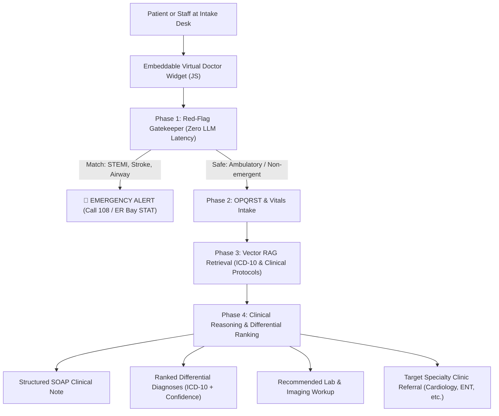

# Virtual Doctor Core (`virtual-doctor-core`)

[](https://github.com/hospitalmanagementsystem587-gif/virtual-doctor-core)
[](LICENSE)
[](https://www.python.org/)
[](https://fastapi.tiangolo.com/)

A clinical-grade, fool-proof **Virtual Doctor & Clinical Triage Copilot** designed for direct embedding into hospital public websites (`sastahospital.in`, Vedant Hospital), patient portals, and outpatient department (OPD) intake desks.

---

## 🏥 Why This Is Built Better (The Problem with Generic LLM Doctors)

Standard consumer symptom checkers (WebMD, generic LLMs) fail in hospital production because:
1. **Hallucination Risk:** They guess rare diseases without grounding.
2. **Missing Emergency Safeguards:** They delay critical care by engaging in long conversation during acute heart attacks or strokes.
3. **Unstructured Output:** Attending physicians don't have time to read 10 paragraphs of chat transcripts.

### Our 4-Pillar Clinical Architecture:
1. **Zero-Latency Red-Flag Gatekeeper:** Evaluates acute, life-threatening symptoms (ACS chest pain, stroke FAST, severe stridor, anaphylaxis) with instantaneous hard rules. Halts routine intake and directs immediate EMS / 108 emergency escalation.
2. **Structured Clinical Interview (OPQRST + AS-PN):** Methodically structures history of presenting illness (Onset, Provocation, Quality, Radiation, Severity 1-10, Timing, Associated Symptoms & Pertinent Negatives).
3. **Grounded Medical Vector RAG:** Ranks differential diagnoses strictly verified against ICD-10 protocols and clinical guidelines with explicit confidence scoring.
4. **Physician-Grade SOAP Handoff Note:** Formats a clean **SBAR / SOAP** note (Subjective, Objective, Assessment, Plan) that attending doctors and triage nurses can review in 10 seconds.

---

## 🛠 Architecture & Workflow



---

## 🚀 Quickstart & Local Setup

### 1. Clone & Setup Environment
```bash
git clone https://github.com/hospitalmanagementsystem587-gif/virtual-doctor-core.git
cd virtual-doctor-core
python3 -m venv .venv && source .venv/bin/activate
pip install -r requirements.txt
cp .env.example .env
```

### 2. Run the API Server
```bash
uvicorn app.main:app --host 0.0.0.0 --port 8010 --reload
```
* **API Documentation (Swagger UI):** `http://localhost:8010/docs`
* **Interactive Widget Demo:** `http://localhost:8010/widget/demo.html`

### 3. Run Automated Clinical Test Suite
```bash
pytest -v tests/
```

---

## 🌐 Embed in Any Hospital Website or Portal

Add this lightweight 2-line snippet to any HTML page:

```html
<!-- 1. Include SDK Script -->
<script src="https://your-virtual-doctor.onrender.com/widget/virtual-doctor.js"></script>

<!-- 2. Initialize Widget -->
<script>
  window.addEventListener('DOMContentLoaded', () => {
    new VirtualDoctorWidget({
      apiBase: "https://your-virtual-doctor.onrender.com",
      hospitalName: "Vedant Hospital Virtual Doctor",
      themeColor: "#53172a"
    });
  });
</script>
```

---

## 🛡️ Clinical API Endpoints

### 1. Symptom Assessment & Triage
`POST /api/v1/assess`
```json
{
  "patient": {
    "age": 42,
    "gender": "male",
    "chronic_conditions": ["Hypertension"],
    "known_allergies": []
  },
  "chief_complaint": "Burning retrosternal heartburn and acid regurgitation after meals",
  "onset": "Recurring over 2 weeks, worse when lying flat at night",
  "quality_character": "Burning retrosternal pyrosis",
  "severity_scale": 4,
  "associated_symptoms": ["Sour taste in mouth"],
  "pertinent_negatives": ["No dysphagia", "No vomiting blood"]
}
```

### Response:
```json
{
  "encounter_id": "ENC-A9B8C7D6E5",
  "triage_level": "ROUTINE_GREEN",
  "recommended_specialty_clinic": "Gastroenterology",
  "differential_diagnoses": [
    {
      "diagnosis_name": "Gastroesophageal Reflux Disease (GERD) & Reflux Esophagitis",
      "icd10_code": "K21.9",
      "probability_rank": 1,
      "confidence_score": 0.82,
      "clinical_rationale": "Patient presentation of retrosternal heartburn aligns closely with GERD."
    }
  ],
  "soap_note": {
    "subjective": "42-year-old male presents with burning retrosternal heartburn...",
    "objective": "Severity rating: 4/10. Chronic history: Hypertension...",
    "assessment": "Clinical presentation is most consistent with GERD (Confidence: 82%)...",
    "plan": "1. Schedule targeted OPD evaluation with Gastroenterology..."
  }
}
```

---

## 📜 Regulatory & Safety Disclaimer
This tool is a **Clinical Decision Support & Triage Copilot**. It is intended to assist healthcare staff and inform patients by organizing clinical histories and recommending evidence-based workup options. It does not replace formal clinical diagnosis, physical examination, or statutory medical licensing.
